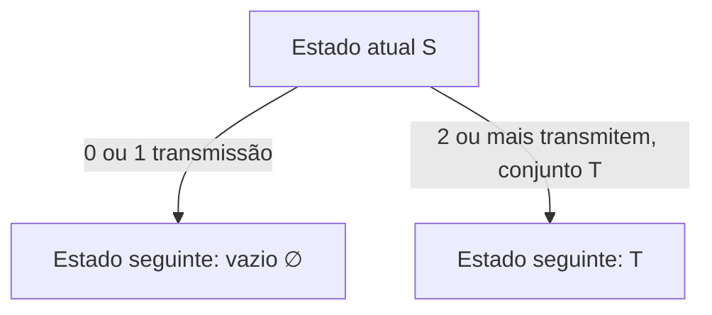

# Exercício 2 — Slotted Aloha com probabilidade adaptativa

**Disciplina:** Avaliação de Desempenho de Sistemas — IFSC  
**Modelo:** cadeia de Markov em tempo discreto (DTMC), com cinco estações.

Este diretório reúne a formulação matemática, a implementação em Python, testes automatizados, resultados numéricos de referência e instruções para executar e interpretar o exercício.

## 1. O que o exercício pede

O enunciado apresenta um Slotted Aloha com cinco estações e probabilidade de transmissão adaptativa. Para entregar o exercício, é necessário:

1. Definir uma DTMC e justificar o espaço de estados.
2. Construir o diagrama de transições e a matriz de transição $P$.
3. Calcular a distribuição estacionária.
4. Calcular a vazão média, em pacotes entregues por slot.
5. Calcular a proporção de slots ociosos.
6. Apresentar exemplos numéricos para valores que satisfaçam $0 < b < a < 1$.

O programa calcula esses resultados para valores escolhidos de $a$ e $b$. Também executa uma simulação de Monte Carlo para comparar resultados teóricos com resultados empíricos.

## 2. Regras modeladas

- Existem cinco estações, identificadas pelos números 1 a 5.
- Uma estação que está usando a probabilidade normal transmite com probabilidade $a$ no slot.
- Uma estação que participou de uma colisão no slot anterior usa probabilidade $b$ no slot atual, com $0 < b < a < 1$.
- Se exatamente uma estação transmitir, o pacote é entregue com sucesso.
- Se nenhuma estação transmitir, o slot fica ocioso.
- Se duas ou mais estações transmitirem, há colisão e os pacotes envolvidos são descartados.
- A adaptação é de um slot: as estações que colidiram no slot atual são as que usarão $b$ no próximo slot. As estações que não participam dessa nova colisão voltam a usar $a$.

As tentativas de transmissão das estações são consideradas independentes, condicionadas ao estado atual. Não há fila persistente nem retransmissão dos pacotes colididos neste exercício.

## 3. Definição da DTMC

### 3.1 Espaço de estados

O estado é o conjunto de estações que participaram da colisão no slot imediatamente anterior. O estado vazio representa a situação em que nenhuma estação precisa usar a probabilidade reduzida.

$$
\mathcal{S}=\{\varnothing\}\cup
\{S\subseteq\{1,2,3,4,5\}:|S|\geq 2\}.

$$
Exemplos:

- $\varnothing$: todas as estações usam $a$.
- $\{1,3\}$: as estações 1 e 3 colidiram no slot anterior e usam $b$ neste slot; as outras usam $a$.
- $\{1,2,3,4,5\}$: as cinco estações participaram da colisão anterior e usam $b$ neste slot.

Um estado não vazio precisa ter no mínimo duas estações, porque uma colisão só acontece quando duas ou mais transmitem. Conjuntos unitários não são estados: um slot com somente uma transmissão é um sucesso e não deixa estações em adaptação para o slot seguinte.

A quantidade de estados é:

$$
|\mathcal{S}|=1+\sum_{k=2}^{5}\binom{5}{k}
=1+(32-1-5)=27.

$$
Essa representação guarda a informação necessária para definir as probabilidades de transmissão no próximo slot e, por isso, preserva a propriedade de Markov.

### 3.2 Probabilidade de transmissão por estação

Para um estado $S$, a probabilidade de transmissão da estação $i$ é:

$$
p_i(S)=
\begin{cases}
b,&i\in S,\\
a,&i\notin S.
\end{cases}

$$
Se $T$ representa exatamente o conjunto de estações que transmitem no slot atual, então:

$$
\Pr(T\mid S)=
\prod_{i\in T}p_i(S)
\prod_{j\notin T}(1-p_j(S)).

$$
Essa expressão considera que as estações em $T$ transmitem e todas as demais ficam em silêncio.

### 3.3 Matriz de transição $P$

O próximo estado é o conjunto exato de estações que colidiram no slot atual. Para um conjunto $T$ com pelo menos duas estações:

$$
P_{S,T}=
\prod_{i\in T}p_i(S)
\prod_{j\notin T}(1-p_j(S)).

$$
O próximo estado será vazio se zero ou uma estação transmitir:

$$
P_{S,\varnothing}=
\prod_{i=1}^{5}(1-p_i(S))
+
\sum_{i=1}^{5}p_i(S)
\prod_{\substack{j=1\\j\ne i}}^{5}(1-p_j(S)).

$$
O primeiro termo é a probabilidade de slot ocioso. A soma é a probabilidade de exatamente uma estação transmitir. Ambos levam ao estado vazio porque não há uma nova colisão que provoque adaptação.

O programa monta a matriz $P$, de dimensão $27\times27$, diretamente a partir dessas probabilidades. Uma verificação importante é:

$$
\sum_{T\in\mathcal{S}}P_{S,T}=1
\quad\text{para cada estado }S.

$$
O código mede o erro numérico máximo dessa condição e o imprime ao final.

Um exemplo da linha correspondente ao estado vazio ajuda a conferir a matriz. Nesse estado, todas as estações usam $a$:

$$
P_{\varnothing,\varnothing}=(1-a)^5+5a(1-a)^4.

$$
Para qualquer conjunto $T$ com $k\geq2$ estações, a probabilidade de ir do estado vazio a $T$ é $a^k(1-a)^{5-k}$. Com $a=0{,}30$, a linha começa com $P_{\varnothing,\varnothing}=0{,}52822$; cada estado de colisão de tamanho 2 tem probabilidade $0{,}03087$, de tamanho 3 tem $0{,}01323$, de tamanho 4 tem $0{,}00567$ e de tamanho 5 tem $0{,}00243$. Somando as 27 entradas dessa linha, obtém-se 1.

O programa exporta a matriz completa para resultados/matriz_transicao_P.csv. As linhas identificam o estado atual e as colunas o próximo estado.

### 3.4 Diagrama de transições

O diagrama completo tem 27 estados e muitas transições. A regra que permite reconstruí-lo sem desenhar 27 caixas é:

- De qualquer estado $S$, considere quais estações transmitem usando as probabilidades $p_i(S)$.
- Se nenhuma ou apenas uma estação transmitir, a transição vai para $\varnothing$.
- Se o conjunto de estações que transmite for $T$, com $|T|\geq2$, ocorre colisão e a transição vai para o estado $T$.
- A probabilidade da transição é a probabilidade de exatamente esse conjunto $T$ transmitir.

Assim, o diagrama e a matriz representam a mesma regra; cada entrada $P_{S,T}$ é a probabilidade da seta de $S$ para $T$.

Esquema geral das transições (os 27 estados concretos seguem essa mesma regra):

A seta para o estado vazio reúne os casos sem colisão; a seta para T existe para cada conjunto T com duas ou mais estações. A probabilidade de cada seta é calculada pelas fórmulas acima.

### 3.5 Distribuição estacionária

A distribuição estacionária $\pi$ representa a fração de longo prazo em cada estado. Ela é obtida resolvendo:

$$
\pi P=\pi,\qquad
\sum_{S\in\mathcal{S}}\pi_S=1.

$$
O programa resolve numericamente esse sistema com NumPy. Como $0<b<a<1$, cada padrão possível de transmissão tem probabilidade positiva. A cadeia definida é comunicante e possui distribuição estacionária única.

### 3.6 Vazão média

A probabilidade de sucesso em um estado $S$ é a probabilidade de exatamente uma das cinco estações transmitir:

$$
Q(S)=\sum_{i=1}^{5}
p_i(S)\prod_{\substack{j=1\\j\ne i}}^{5}(1-p_j(S)).

$$
Como cada slot bem-sucedido entrega exatamente um pacote, a vazão média é:

$$
\boxed{Q=\sum_{S\in\mathcal{S}}\pi_S Q(S)}

$$
A unidade é pacotes entregues por slot.

### 3.7 Proporção de slots ociosos

A probabilidade de nenhuma estação transmitir, dado o estado $S$, é:

$$
I(S)=\prod_{i=1}^{5}(1-p_i(S)).

$$
A proporção média de slots ociosos é:

$$
\boxed{I=\sum_{S\in\mathcal{S}}\pi_S I(S)}

$$
Como verificação adicional, a proporção de slots com colisão é calculada por:

$$
C=1-Q-I.

$$
As três proporções devem somar 1, considerando pequenas diferenças de arredondamento.

## 4. Arquivos do projeto

    Exercicio_2_Slotted_Aloha/
    ├── README.md
    ├── slotted_aloha.py
    ├── test_model.py
    ├── requirements.txt
    ├── .gitignore
    └── resultados/                  (criada ao executar)
        ├── resumo_resultados.json
        ├── distribuicao_estacionaria.csv
        └── matriz_transicao_P.csv

- **slotted_aloha.py:** cria os 27 estados, monta $P$, resolve a distribuição estacionária, calcula desempenho, executa a simulação e grava os resultados.
- **test_model.py:** verifica propriedades matemáticas básicas do modelo.
- **requirements.txt:** lista a dependência necessária.
- **resultados/resumo_resultados.json:** reúne os resumos teórico e simulado.
- **resultados/distribuicao_estacionaria.csv:** contém uma linha para cada estado, com a probabilidade estacionária e as métricas condicionais do slot.
- **resultados/matriz_transicao_P.csv:** exporta a matriz de transição completa $27\times27$; a primeira coluna identifica o estado de origem e as outras colunas indicam os estados de destino.

A pasta de resultados é criada automaticamente quando o programa é executado. Arquivos CSV e JSON gerados são ignorados pelo Git para evitar que cada execução altere o repositório.

## 5. Requisitos

- Python 3.9 ou superior.
- pip.
- NumPy, instalado a partir de requirements.txt.

Confira se Python e pip estão disponíveis:

    python3 --version
    python3 -m pip --version

## 6. Como executar no Linux

### Passo 1 — Clonar o repositório

Execute no terminal:

    git clone https://github.com/BeatrizPAbreu/ADS.git
    cd ADS/Exercicio_2_Slotted_Aloha

Se o repositório já estiver no computador, não é necessário cloná-lo novamente; basta entrar na pasta.

### Passo 2 — Criar e ativar um ambiente virtual

    python3 -m venv .venv
    source .venv/bin/activate

O ambiente virtual mantém as bibliotecas deste exercício separadas das demais instalações Python.

### Passo 3 — Instalar a dependência

    python -m pip install --upgrade pip
    python -m pip install -r requirements.txt

### Passo 4 — Executar o programa

Use os parâmetros de referência $a=0{,}30$ e $b=0{,}10$, com 100.000 slots na simulação:

    python slotted_aloha.py --a 0.30 --b 0.10 --simulate 100000 --seed 2026

O terminal mostrará os resultados teóricos e simulados. Os arquivos serão gravados na pasta resultados.

### Passo 5 — Abrir os arquivos gerados

Para ver todos os resultados, abra:

- resultados/resumo_resultados.json em um editor de texto.
- resultados/distribuicao_estacionaria.csv no LibreOffice Calc, Excel ou outro leitor de CSV.
- resultados/matriz_transicao_P.csv no LibreOffice Calc ou Excel para inspecionar os 27 × 27 elementos de $P$.

### Passo 6 — Executar os testes

Com o ambiente virtual ativado:

    python -m unittest -v

Os testes verificam o número de estados, as somas das linhas de $P$, a normalização e estacionariedade de $\pi$, e o fechamento das probabilidades de desempenho.

### Windows (PowerShell)

Depois de entrar na pasta do exercício, os comandos equivalentes são:

    py -m venv .venv
    .\.venv\Scripts\Activate.ps1
    py -m pip install -r requirements.txt
    py slotted_aloha.py --a 0.30 --b 0.10 --simulate 100000 --seed 2026
    py -m unittest -v

## 7. Parâmetros do programa

| Parâmetro | Significado | Valor padrão |
|---|---|---:|
| --a | Probabilidade de transmissão normal | 0.30 |
| --b | Probabilidade reduzida após colisão | 0.10 |
| --simulate | Quantidade de slots na simulação Monte Carlo | 100000 |
| --seed | Semente aleatória para reproduzir a simulação | 2026 |
| --output-dir | Pasta onde salvar CSV e JSON | resultados |

É obrigatório respeitar $0<b<a<1$. O programa encerra com uma mensagem de erro se os valores não atenderem à condição ou se o número de slots de simulação não for positivo.

Exemplos com outras configurações:

    python slotted_aloha.py --a 0.20 --b 0.05 --simulate 200000 --seed 7
    python slotted_aloha.py --a 0.40 --b 0.10 --simulate 200000 --seed 7 --output-dir resultados_a040_b010

O segundo exemplo salva os arquivos em uma pasta diferente, preservando os resultados da primeira configuração.

## 8. Resultados numéricos de referência

Para $a=0{,}30$, $b=0{,}10$, 100.000 slots simulados e semente 2026, a execução de referência apresentou:

| Métrica | DTMC (teórico) | Monte Carlo (100.000 slots) |
|---|---:|---:|
| Vazão (pacotes/slot) | 0,383423 | 0,381430 |
| Slots ociosos | 22,3211% | 22,2420% |
| Slots com colisão | 39,3366% | 39,6150% |

Verificações numéricas dessa execução:

- Foram construídos 27 estados.
- A soma das probabilidades estacionárias é 1.
- A soma de cada linha de $P$ é 1, com erro numérico máximo da ordem de $10^{-15}$.
- Vazão + proporção de slots ociosos + proporção de slots com colisão = 1, salvo arredondamento.

A simulação é aleatória, portanto os valores empíricos podem mudar quando a semente ou a quantidade de slots mudar. Para os mesmos $a$ e $b$, os valores teóricos não devem mudar.

## 9. Como interpretar e discutir os resultados

- **Vazão:** o valor 0,383423 significa que, no longo prazo, são entregues em média cerca de 0,383 pacotes por slot. Não significa que 38,3% das estações transmitem.
- **Slots ociosos:** aproximadamente 22,32% dos slots não têm nenhuma transmissão.
- **Slots com colisão:** aproximadamente 39,34% dos slots têm duas ou mais transmissões. Os pacotes envolvidos são descartados e não contam para a vazão.
- **Teoria versus simulação:** resultados próximos são esperados, mas não precisam ser idênticos devido à variação aleatória e ao tamanho finito da simulação.
- **Efeito de $a$ e $b$:** $a$ controla a chance normal de transmitir; $b$ reduz temporariamente a chance das estações que colidiram. A mudança na vazão depende dos dois parâmetros. Não é correto afirmar que diminuir $b$ sempre aumenta a vazão sem comparar configurações.

Para uma discussão mais completa, execute o programa com diferentes pares $a,b$, anote as três métricas e compare como a carga oferecida e a redução após colisão alteram o desempenho.

## 10. Hipóteses e limites

- São consideradas cinco estações e slots sincronizados.
- Cada estação tenta transmitir no máximo um pacote por slot.
- Um sucesso entrega exatamente um pacote.
- Os pacotes envolvidos em colisão são descartados.
- Não há fila persistente nem retransmissão neste Exercício 2.
- As decisões de transmissão são independentes, condicionadas ao estado atual.
- Os valores de referência são apenas um exemplo numérico; use os parâmetros que forem exigidos pelo professor, se forem diferentes.

## 11. Checklist de entrega

- [x] Definição e justificativa dos estados da DTMC.
- [x] Matriz de transição $P$ construída e exportada em CSV.
- [x] Distribuição estacionária calculada numericamente.
- [x] Vazão média calculada.
- [x] Proporção de slots ociosos calculada.
- [x] Exemplo numérico e comparação com simulação.
- [x] Instruções de instalação, execução e interpretação.
- [x] Testes automatizados.

**Importante:** $a=0{,}30$ e $b=0{,}10$ são valores de exemplo escolhidos para demonstrar o programa, não valores especificados pelo enunciado. Caso o professor forneça outros valores, informe-os por meio dos argumentos --a e --b e gere os resultados novamente.
